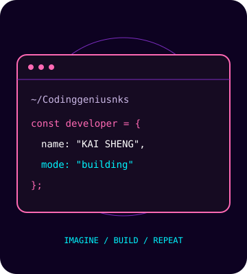

<picture>
  <source media="(prefers-color-scheme: dark)" srcset="https://capsule-render.vercel.app/api?type=waving&color=0:0D0221,50:7B2CBF,100:FF69B4&height=190&section=header" />
  <source media="(prefers-color-scheme: light)" srcset="https://capsule-render.vercel.app/api?type=waving&color=0:FFF0F6,50:E0AAFF,100:FF69B4&height=190&section=header" />
  
</picture>

<h1 align="center">Hey there, I'm KAI SHENG</h1>

  

<samp>[YOUR ROLE] &nbsp;✦&nbsp; [YOUR SPECIALTY] &nbsp;✦&nbsp; [YOUR LOCATION]</samp>

  
  
  

 

<h2 align="center">✦ About Me</h2>

<table align="center" width="100%">
  <tr>
    <td width="65%" align="center" valign="middle">
      <h3>Curiosity fuels everything I build.</h3>
      
I'm <strong>KAI SHENG</strong>, a <strong>[YOUR ROLE]</strong> interested in <strong>[YOUR AREA OF INTEREST]</strong>.

      
🔭 <strong>Building</strong> [YOUR CURRENT PROJECT]

      
🌱 <strong>Learning</strong> [TECHNOLOGIES YOU ARE EXPLORING]

      
🤝 <strong>Open to collaborating on</strong> [YOUR COLLABORATION INTERESTS]

      
⚡ <strong>Beyond the keyboard</strong> [YOUR HOBBY OR FUN FACT]

    </td>
    <td width="35%" align="center" valign="middle">
      
        <samp>imagine · build · repeat</samp>
    </td>
  </tr>
</table>

 

<h2 align="center">✦ Tech Stack</h2>

<samp>[SAMPLE STACK — REPLACE WITH YOUR TECHNOLOGIES]</samp>

<strong>Languages &amp; Frontend</strong>

  <picture>
    <source media="(prefers-color-scheme: light)" srcset="https://skillicons.dev/icons?i=html,css,js,ts,react,nextjs&theme=light&perline=6" />
    
  </picture>

<strong>Backend &amp; Data</strong>

  <picture>
    <source media="(prefers-color-scheme: light)" srcset="https://skillicons.dev/icons?i=nodejs,express,python,postgres,mongodb,redis&theme=light&perline=6" />
    
  </picture>

<strong>Tools &amp; Workflow</strong>

  <picture>
    <source media="(prefers-color-scheme: light)" srcset="https://skillicons.dev/icons?i=git,github,docker,linux,vscode,figma&theme=light&perline=6" />
    
  </picture>

 

<h2 align="center">✦ GitHub Activity</h2>

<samp>Small commits. Steady progress.</samp>

  

  

 

<h2 align="center">✦ Contribution Snake</h2>

<samp>One contribution at a time.</samp>

<!-- GitHub Action: .github/workflows/snake.yml generates these SVGs daily and publishes them to the output branch. Run it manually from the Actions tab anytime. -->

  <picture>
    <source media="(prefers-color-scheme: dark)" srcset="https://raw.githubusercontent.com/Codinggeniusnks/Codinggeniusnks/output/github-contribution-grid-snake-dark.svg" />
    <source media="(prefers-color-scheme: light)" srcset="https://raw.githubusercontent.com/Codinggeniusnks/Codinggeniusnks/output/github-contribution-grid-snake.svg" />
    
  </picture>

 

<h2 align="center">✦ Let's Connect</h2>

Have an idea worth building? <strong>Let's start a conversation.</strong>

<!-- Replace ng-kai-sheng-64ab9942b with your LinkedIn profile slug. -->

  
  

 

<samp>Thanks for stopping by. See you in the next commit.</samp>

✦ &nbsp; 💗 &nbsp; ✦

