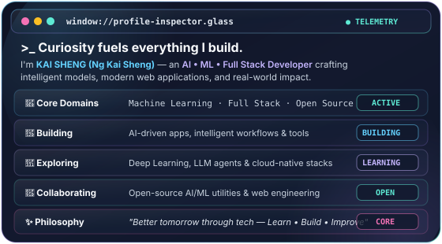

<!-- ═══════════════════════════════════════════════════════════════════════════
     🪟 HERO BANNER & SOFT CYBERPUNK HEADER
     ═══════════════════════════════════════════════════════════════════════════ -->
<picture>
  <source media="(prefers-color-scheme: dark)" srcset="./assets/banner.png" />
  <source media="(prefers-color-scheme: light)" srcset="./assets/banner.png" />
  
</picture>

 

<h1 align="center">Hey there, I'm KAI SHENG</h1>

<!-- ─── SOFT EYE-COMFORT TYPING SVG (#5EEAD4 Soft Mint / Seafoam) ─── -->

  

<!-- ─── SOFT EYE-COMFORT FLOATING STATUS PILLS ─── -->

  
  &nbsp;
  
  &nbsp;
  
  &nbsp;
  

 

<!-- ═══════════════════════════════════════════════════════════════════════════
     🪟 CINEMATIC GLASSMORPHISM HIGHLIGHTS PANEL
     ═══════════════════════════════════════════════════════════════════════════ -->

  

 

<!-- ═══════════════════════════════════════════════════════════════════════════
     🪟 ABOUT ME SECTION (65% CINEMATIC GLASS CARD / 35% AVATAR)
     ═══════════════════════════════════════════════════════════════════════════ -->
<table align="center" width="100%">
  <tr>
    <td width="65%" align="center" valign="middle">
      
    </td>
    <td width="35%" align="center" valign="middle">
       
      
        
      
      &nbsp;
      
        
      <samp>&gt;_ imagine · build · improve · repeat</samp>
        
    </td>
  </tr>
</table>

 

<!-- ═══════════════════════════════════════════════════════════════════════════
     🪟 3D CONTRIBUTION & ARCHITECTURE VISUALIZATION + LANGUAGE STACK
     ═══════════════════════════════════════════════════════════════════════════ -->

  

 

<!-- ═══════════════════════════════════════════════════════════════════════════
     🪟 TECH STACK & SKILL MATRIX
     ═══════════════════════════════════════════════════════════════════════════ -->
<table align="center" width="100%">
  <thead>
    <tr>
      <th width="33%" align="center">🧠 AI / ML &amp; Data Science</th>
      <th width="34%" align="center">💻 Full Stack &amp; Frontend</th>
      <th width="33%" align="center">🗄️ Backend, Cloud &amp; DevOps</th>
    </tr>
  </thead>
  <tbody>
    <tr>
      <td align="center" valign="middle">
         
        <picture>
          <source media="(prefers-color-scheme: light)" srcset="https://skillicons.dev/icons?i=py,pytorch,tensorflow,sklearn,opencv,anaconda&theme=light&perline=3" />
          
        </picture>
          
        
         
        <samp>Python · PyTorch · TensorFlow Scikit-Learn · OpenCV · Conda</samp>
          
      </td>
      <td align="center" valign="middle">
         
        <picture>
          <source media="(prefers-color-scheme: light)" srcset="https://skillicons.dev/icons?i=ts,js,react,nextjs,tailwind,html,css,nodejs&theme=light&perline=4" />
          
        </picture>
          
        
         
        <samp>TypeScript · JavaScript · React Next.js · Tailwind · Node.js</samp>
          
      </td>
      <td align="center" valign="middle">
         
        <picture>
          <source media="(prefers-color-scheme: light)" srcset="https://skillicons.dev/icons?i=fastapi,express,postgres,mongodb,redis,docker,git,github,linux,vscode&theme=light&perline=5" />
          
        </picture>
          
        
         
        <samp>FastAPI · Express · Postgres · Mongo Redis · Docker · Git · Linux</samp>
          
      </td>
    </tr>
  </tbody>
</table>

 

<!-- ═══════════════════════════════════════════════════════════════════════════
     🪟 GITHUB STREAK & ACTIVITY TELEMETRY
     ═══════════════════════════════════════════════════════════════════════════ -->
<table align="center" width="100%">
  <tr>
    <td width="48%" align="center" valign="middle">
       
      <samp>⚡ <strong>COMMIT_STREAK_MONITOR</strong></samp>
        
      
       
    </td>
    <td width="52%" align="center" valign="middle">
       
      <samp>📈 <strong>CONTRIBUTION_VELOCITY_GRAPH</strong></samp>
        
      
       
    </td>
  </tr>
</table>

 

<!-- ═══════════════════════════════════════════════════════════════════════════
     🪟 CONTRIBUTION SNAKE MATRIX
     ═══════════════════════════════════════════════════════════════════════════ -->
<!-- GitHub Action: .github/workflows/snake.yml generates these SVGs daily and publishes them to the output branch. Run it manually from the Actions tab anytime. -->
<table align="center" width="100%">
  <tr>
    <td align="center">
       
      <samp>🐍 <strong>NEURAL_CONTRIBUTION_SNAKE</strong> — Consuming commits across the grid</samp>
        
      <picture>
        <source media="(prefers-color-scheme: dark)" srcset="https://raw.githubusercontent.com/Codinggeniusnks/Codinggeniusnks/output/github-contribution-grid-snake-dark.svg" />
        <source media="(prefers-color-scheme: light)" srcset="https://raw.githubusercontent.com/Codinggeniusnks/Codinggeniusnks/output/github-contribution-grid-snake.svg" />
        
      </picture>
        
    </td>
  </tr>
</table>

 

<!-- ═══════════════════════════════════════════════════════════════════════════
     🪟 INITIALIZE CONNECTION DOCK
     ═══════════════════════════════════════════════════════════════════════════ -->
<table align="center" width="100%">
  <tr>
    <td align="center">
       
      

        Have an AI/ML model to train, an open-source idea, or a project worth building? 
        <strong>Let's plug in and start a conversation.</strong>
      

      <!-- Replace ng-kai-sheng-64ab9942b with your custom LinkedIn profile slug if updated -->
      

        
        &nbsp;&nbsp;
        
      

      <samp>&gt;_ System status: ONLINE · Thanks for stopping by. See you in the next commit. 夢</samp>
        
    </td>
  </tr>
</table>

<!-- ─── SOFT EYE-COMFORT CAPSULE RENDER WAVING FOOTER ─── -->
<picture>
  <source media="(prefers-color-scheme: dark)" srcset="https://capsule-render.vercel.app/api?type=waving&color=0:071318,40:115E59,75:38BDF8,100:818CF8&height=130&section=footer" />
  <source media="(prefers-color-scheme: light)" srcset="https://capsule-render.vercel.app/api?type=waving&color=0:071318,40:115E59,75:38BDF8,100:818CF8&height=130&section=footer" />
  
</picture>

