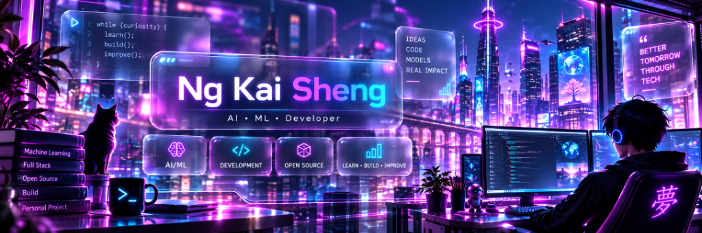
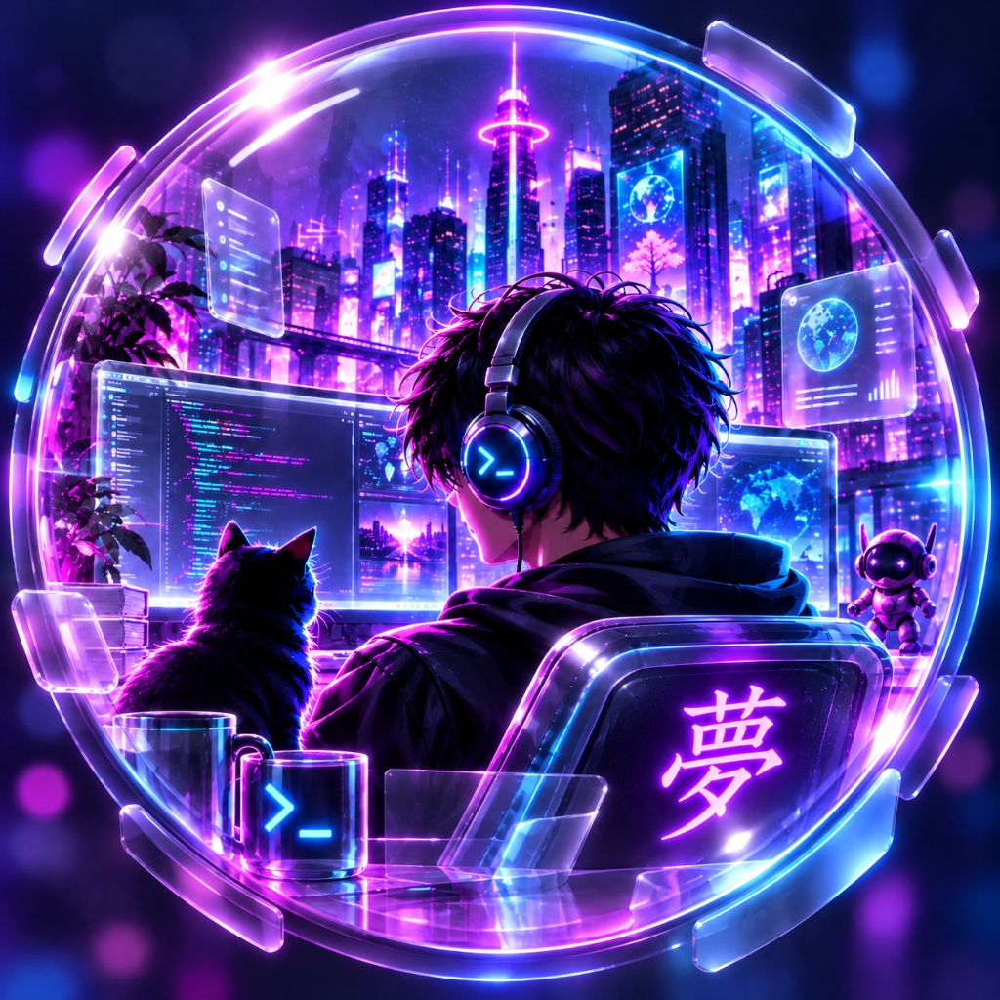

<!-- ─── CYBERPUNK BANNER ─── -->
<picture>
  <source media="(prefers-color-scheme: dark)" srcset="./assets/banner.png" />
  <source media="(prefers-color-scheme: light)" srcset="./assets/banner.png" />
  
</picture>

 

<!-- ─── HERO TITLE ─── -->
<h1 align="center">Hey there, I'm KAI SHENG</h1>

<!-- ─── ANIMATED TYPING SVG ─── -->

  

  <samp>⚡ AI / ML &nbsp;✦&nbsp; 💻 DEVELOPMENT &nbsp;✦&nbsp; 🌐 OPEN SOURCE &nbsp;✦&nbsp; 🚀 LEARN • BUILD • IMPROVE</samp>

<!-- ─── CYBERPUNK GITHUB BADGES ─── -->

  
  &nbsp;
  
  &nbsp;
  

 

<!-- ─── CYBERPUNK DIVIDER ─── -->

  

<!-- ─── ABOUT ME SECTION (65% TEXT / 35% IMAGE) ─── -->
<h2 align="center">⚡ <code>// ABOUT_ME</code></h2>

<table align="center" width="100%">
  <tr>
    <td width="65%" align="center" valign="middle">
      <h3><code>&gt;_</code> Curiosity fuels everything I build.</h3>
      

        I'm <strong>KAI SHENG (Ng Kai Sheng)</strong> — an <strong>AI • ML • Full Stack Developer</strong> passionate about transforming complex ideas into intelligent models, scalable software, and real-world impact.
      

       
      

        🧠 <strong>Focus Areas</strong> 
        <code>Machine Learning</code> • <code>Full Stack Development</code> • <code>Open Source</code>
      

      

        🔭 <strong>Currently Building</strong> 
        AI-driven applications, intelligent workflows &amp; personal tech projects
      

      

        🌱 <strong>Exploring &amp; Improving</strong> 
        Deep Learning architectures, LLM systems &amp; modern cloud-native stacks
      

      

        🤝 <strong>Open to Collaborating On</strong> 
        Open-source AI/ML tools, full-stack web apps &amp; impactful developer utilities
      

      

        ✨ <strong>Philosophy</strong> 
        <em>"Better tomorrow through tech — Learn • Build • Improve"</em>
      

    </td>
    <td width="35%" align="center" valign="middle">
      
        
      <samp>&gt;_ imagine · build · improve · repeat 夢</samp>
    </td>
  </tr>
</table>

 

  

<!-- ─── TECH STACK SECTION ─── -->
<h2 align="center">⚡ <code>// TECH_STACK</code></h2>

<samp>Tools, languages &amp; frameworks powering my neural network</samp>

 

<strong>🧠 AI / Machine Learning &amp; Data Science</strong>

  <picture>
    <source media="(prefers-color-scheme: light)" srcset="https://skillicons.dev/icons?i=py,pytorch,tensorflow,sklearn,opencv,anaconda&theme=light&perline=6" />
    
  </picture>

<strong>💻 Full Stack &amp; Modern Web</strong>

  <picture>
    <source media="(prefers-color-scheme: light)" srcset="https://skillicons.dev/icons?i=ts,js,react,nextjs,nodejs,tailwind,html,css&theme=light&perline=8" />
    
  </picture>

<strong>🗄️ Backend, Databases &amp; DevOps</strong>

  <picture>
    <source media="(prefers-color-scheme: light)" srcset="https://skillicons.dev/icons?i=fastapi,express,postgres,mongodb,redis,docker,git,github,linux,vscode&theme=light&perline=10" />
    
  </picture>

 

  

<!-- ─── GITHUB STREAK + ACTIVITY GRAPH ─── -->
<h2 align="center">⚡ <code>// TELEMETRY_&amp;_ACTIVITY</code></h2>

<samp>Small commits. Steady neural progress.</samp>

 

  

 

  

 

  

<!-- ─── CONTRIBUTION SNAKE SECTION ─── -->
<h2 align="center">⚡ <code>// CONTRIBUTION_SNAKE</code></h2>

<samp>Consuming commits across the grid — one node at a time.</samp>

<!-- GitHub Action: .github/workflows/snake.yml generates these SVGs daily and publishes them to the output branch. Run it manually from the Actions tab anytime. -->

  <picture>
    <source media="(prefers-color-scheme: dark)" srcset="https://raw.githubusercontent.com/Codinggeniusnks/Codinggeniusnks/output/github-contribution-grid-snake-dark.svg" />
    <source media="(prefers-color-scheme: light)" srcset="https://raw.githubusercontent.com/Codinggeniusnks/Codinggeniusnks/output/github-contribution-grid-snake.svg" />
    
  </picture>

 

  

<!-- ─── CONNECT SECTION ─── -->
<h2 align="center">⚡ <code>// INITIALIZE_CONNECTION</code></h2>

  Have an AI/ML model to train, an open-source idea, or a project worth building? 
  <strong>Let's plug in and start a conversation.</strong>

<!-- Replace ng-kai-sheng-64ab9942b with your custom LinkedIn profile slug if updated -->

  
  &nbsp;&nbsp;
  

 

<samp>&gt;_ System status: ONLINE · Thanks for stopping by. See you in the next commit.</samp>

✦ &nbsp; 夢 &nbsp; ✦

<!-- ─── CYBERPUNK CAPSULE RENDER WAVING FOOTER ─── -->
<picture>
  <source media="(prefers-color-scheme: dark)" srcset="https://capsule-render.vercel.app/api?type=waving&color=0:090117,35:7209B7,70:FF007F,100:00F5FF&height=140&section=footer" />
  <source media="(prefers-color-scheme: light)" srcset="https://capsule-render.vercel.app/api?type=waving&color=0:090117,35:7209B7,70:FF007F,100:00F5FF&height=140&section=footer" />
  
</picture>

