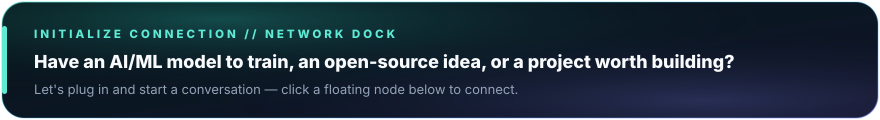

<!-- ═══════════════════════════════════════════════════════════════════════════
     🪟 HERO BANNER & SOFT CYBERPUNK HEADER
     ═══════════════════════════════════════════════════════════════════════════ -->
<picture>
  <source media="(prefers-color-scheme: dark)" srcset="./assets/banner.png" />
  <source media="(prefers-color-scheme: light)" srcset="./assets/banner.png" />
  
</picture>

 

<h1 align="center">Hey there, I'm KAI SHENG</h1>

<!-- ─── SOFT EYE-COMFORT TYPING SVG (#5EEAD4 Soft Mint / Seafoam) ─── -->

  

<!-- ─── CURVED FLOATING GLASS PILL BUTTONS (WITH LIGHT WAVING SHIMMER) ─── -->

  
  &nbsp;&nbsp;
  
  &nbsp;&nbsp;
  

 

<!-- ═══════════════════════════════════════════════════════════════════════════
     🪟 FLOATING GLASS WINDOW 01 // HIGHLIGHTS & CORE FOCUS
     ═══════════════════════════════════════════════════════════════════════════ -->

  

 

<!-- ═══════════════════════════════════════════════════════════════════════════
     🪟 FLOATING GLASS WINDOW 02 // ABOUT ME & AVATAR NODE (65% / 35%)
     ═══════════════════════════════════════════════════════════════════════════ -->
<table align="center" width="100%">
  <tr>
    <td width="65%" align="center" valign="middle">
      
    </td>
    <td width="35%" align="center" valign="middle">
       
      
        
      
       
    </td>
  </tr>
</table>

 

<!-- ═══════════════════════════════════════════════════════════════════════════
     🪟 FLOATING GLASS WINDOW 03 // 3D CONTRIBUTION & LANGUAGE STACK MATRIX
     ═══════════════════════════════════════════════════════════════════════════ -->

  

 

<!-- ═══════════════════════════════════════════════════════════════════════════
     🪟 FLOATING GLASS WINDOW 04 // NEURAL TECH STACK & SKILL ICONS
     ═══════════════════════════════════════════════════════════════════════════ -->

  

  <picture>
    <source media="(prefers-color-scheme: light)" srcset="https://skillicons.dev/icons?i=py,pytorch,tensorflow,sklearn,opencv,anaconda,ts,js,react,nextjs,tailwind,nodejs,fastapi,postgres,mongodb,docker,git,linux&theme=light&perline=9" />
    
  </picture>

 

<!-- ═══════════════════════════════════════════════════════════════════════════
     🪟 FLOATING GLASS WINDOW 05 // LIVE STREAK & VELOCITY TELEMETRY
     ═══════════════════════════════════════════════════════════════════════════ -->

  

  
  &nbsp;
  

 

<!-- ═══════════════════════════════════════════════════════════════════════════
     🪟 FLOATING GLASS WINDOW 06 // CONTRIBUTION SNAKE MATRIX
     ═══════════════════════════════════════════════════════════════════════════ -->
<!-- GitHub Action: .github/workflows/snake.yml generates these SVGs daily and publishes them to the output branch. Run it manually from the Actions tab anytime. -->

  

  <picture>
    <source media="(prefers-color-scheme: dark)" srcset="https://raw.githubusercontent.com/Codinggeniusnks/Codinggeniusnks/output/github-contribution-grid-snake-dark.svg" />
    <source media="(prefers-color-scheme: light)" srcset="https://raw.githubusercontent.com/Codinggeniusnks/Codinggeniusnks/output/github-contribution-grid-snake.svg" />
    
  </picture>

 

<!-- ═══════════════════════════════════════════════════════════════════════════
     🪟 FLOATING GLASS WINDOW 07 // INITIALIZE CONNECTION DOCK
     ═══════════════════════════════════════════════════════════════════════════ -->

  

<!-- Replace ng-kai-sheng-64ab9942b with your custom LinkedIn profile slug if updated -->

  
  &nbsp;&nbsp;&nbsp;
  

  

<samp>&gt;_ System status: ONLINE · Thanks for stopping by. See you in the next commit. 夢</samp>

<!-- ─── SOFT EYE-COMFORT CAPSULE RENDER WAVING FOOTER ─── -->
<picture>
  <source media="(prefers-color-scheme: dark)" srcset="https://capsule-render.vercel.app/api?type=waving&color=0:071318,40:115E59,75:38BDF8,100:818CF8&height=130&section=footer" />
  <source media="(prefers-color-scheme: light)" srcset="https://capsule-render.vercel.app/api?type=waving&color=0:071318,40:115E59,75:38BDF8,100:818CF8&height=130&section=footer" />
  
</picture>

